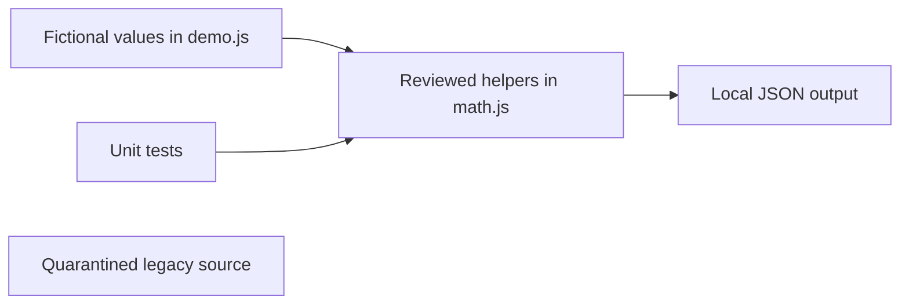

# MEXC Order Book and Strategy Research

**Portfolio category: Programming / Software Engineering.**

An offline order-book calculation package extracted from a larger MEXC strategy program. The original contains fair-price futures trading, take-profit and stop-loss management, position reconciliation, Telegram controls, GMGN adapters and spot/futures arbitrage code. GMGN and spot/futures strategy flags are false; spot/futures startup is removed. Those code paths are not presented as active deployments.

This repository's runnable component is an **offline demonstration**. The network-enabled source in `legacy/` stops immediately before loading dependencies, reading credentials or creating connections. There is no environment switch to enable it. This is not a paper-trading engine or a backtest.

## Problem and scope

Make selected existing algorithms inspectable and repeatable without exchange access, account credentials or real trades. Source provenance: `spread.js` from the original local portfolio.

## Implemented offline features

- VWAP over bounded depth with contract-size conversion
- Partial-level sizing under a basis-point slippage target
- Separate long/short capacity and conservative depth metrics
- Validation of crossed, unsorted, non-finite and invalid books

## Technology and architecture

Runnable code uses CommonJS and Node built-ins only. Historical dependencies and services:

- axios, ws, node-telegram-bot-api and protobufjs; Node crypto, https, fs, events and child_process
- MEXC spot/futures, GMGN WebSockets and Telegram

Historical flow: Ticker/depth streams → freshness and liquidity filters → sizing and strategy state → signed spot/web-session futures requests → position streams, persistence and Telegram controls.



## Requirements and installation

Use Node.js 18 or later and npm. There are no runtime package dependencies for the offline commands; no install is required.

From this repository's directory:

```sh
npm run check
npm test
npm run demo
```

`src/demo.js` is the example input and output entry point. Change only fictional values to explore helper behavior. Demos do not load the legacy source or any credential file.

## Configuration

Offline examples require no configuration. `.env.example` lists fictional placeholders for historical adapters. `src/config.js` reads environment variables but does not automatically parse `.env`; environment values must be explicitly exported by the caller. It is not imported by the offline demo. Do not add real values to examples, source files or commits.

## Security considerations

No credentials are needed for the offline package. Legacy PM2 calls now use execFile argument arrays and the credential-file update operation is disabled in the copy.

The original automatically installed dependencies during startup; that behavior has been removed in the copy. The unconditional legacy guard also blocks trade submission and network notification paths. Removing that guard is a separate engineering task requiring review and simulated integration tests. Do not run original trading scripts for a syntax check.

## Testing and verification

5 calculation test cases passed locally with Node.js 24.14.0. `npm run check`, `npm test` and `npm run demo` completed successfully. Tests cover the public examples and selected helpers; they do not exercise the exchange state machine. The [GitHub Actions workflow](https://github.com/Psiblame/mexc-market-research/actions/workflows/check.yml) runs these offline checks on pushes and pull requests.

## Known limitations

- The legacy program is a large monolith with duplicated startSpreadBlacklistReloader declarations and shared mutable state.
- Offline math uses floating-point values and assumes sorted valid levels; wrappers validate the public entry point.
- Legacy max leverage and large balance allocations are not validated risk controls.
- Retries, partial fills, order idempotency, funding, fees and crash recovery still require a simulated exchange.
- Local support files and adapter dependencies are missing from the original workspace.

## Future improvements

Separate exchange transport from strategy state, record synthetic fill events and test retry/reconnect paths deterministically. Introduce decimal or fixed-point arithmetic before interpreting results as financial calculations. Resolve, audit and lock historical dependencies before adding any network adapter.

## Repository scope and licensing

This repository contains a sanitized source snapshot and offline helpers. The original Git history is not included. No license has been selected. The network runtime remains unsupported.
